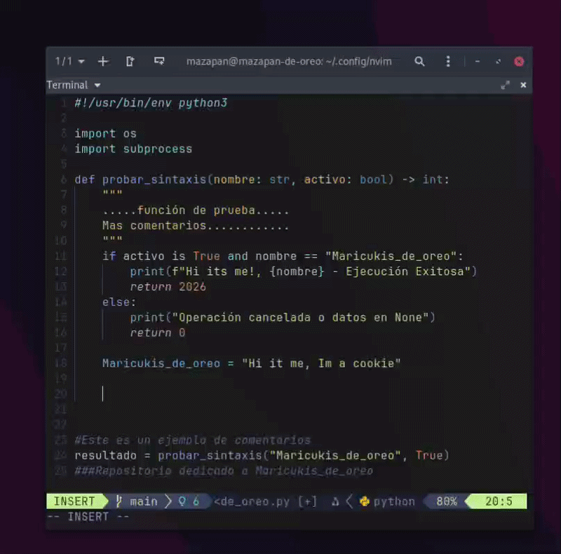
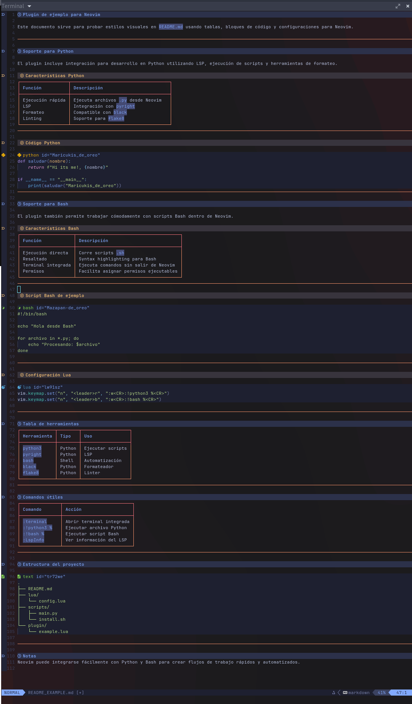

# Neovim para Python en Debian y Ubuntu

Configuración de Neovim con autocompletado, diagnóstico, snippets, exploración de archivos y resaltado de código. Requiere **Neovim 0.11.3 o superior**, Internet y un usuario con acceso a `sudo` durante la instalación. El instalador admite Linux x86_64 y arm64; se ha preparado para Debian Trixie. Otras versiones de Debian/Ubuntu pueden necesitar ajustes de dependencias o del binario.

## Instalación

Ejecuta como tu usuario habitual, sin anteponer `sudo` al script:

```bash
sudo apt update
sudo apt install git
git clone https://github.com/svilla123/nvim_for_python_developed.git ~/nvim_for_python_developed
cd ~/nvim_for_python_developed
bash install_nvim_to_python.sh
nvim
```

También puedes clonar directamente en `~/.config/nvim` si esa carpeta no existe. El script reconoce ese caso y no mueve el repositorio sobre sí mismo.

### Qué hace el instalador

1. Instala Git, curl, herramientas de compilación, ripgrep, fzf, Python/pip/venv y Node/npm mediante APT. No altera repositorios ni ignora errores de firmas.
2. Conserva Neovim si es 0.11.3 o superior. Si falta o es antiguo, descarga la versión estable oficial y comprueba que arranque antes de instalarla en una carpeta nueva de `/opt`. Un enlace en `/usr/local/bin/nvim` selecciona ese ejecutable; conserva cualquier enlace o ejecutable local anterior con un sufijo de respaldo.
3. Copia `init.lua`, `lua/` y el archivo de versiones al directorio de configuración (`$XDG_CONFIG_HOME/nvim` o `~/.config/nvim`). Si existe una configuración diferente, la mueve a un respaldo con fecha. No copia el antiguo enlace `nvim` del repositorio ni borra respaldos previos.
4. Instala plugins y restaura los commits de `lazy-lock.json`. Mason y Treesitter pueden continuar descargando servidores y analizadores durante el primer inicio; revisa sus resultados.

El script no crea entornos virtuales para tus proyectos. Para uno nuevo:

```bash
mkdir -p ~/Proyecto_AI
cd ~/Proyecto_AI
python3 -m venv .venv
source .venv/bin/activate
nvim main.py
```

## Características

| Función | Herramientas |
|---|---|
| Plugins y versiones reproducibles | Lazy.nvim y `lazy-lock.json` |
| Autocompletado | nvim-cmp: LSP, palabras, rutas y snippets |
| Snippets | LuaSnip y friendly-snippets |
| Python y Lua | Pyright y lua_ls, instalados mediante Mason |
| Resaltado y sangría estructural | nvim-treesitter |
| Archivos | nvim-tree |
| Búsqueda | Telescope y ripgrep |
| Cambios y autoría Git | Gitsigns |
| Apariencia | TokyoNight transparente, lualine e indent-blankline |
| Markdown | render-markdown y analizadores Markdown |

Treesitter usa deliberadamente la rama archivada `master`, fijada por el lockfile, porque esta configuración utiliza `nvim-treesitter.configs`. No cambies a `main` sin migrar también la configuración: su API es distinta. Es una decisión de compatibilidad, no una promesa de mantenimiento futuro de esa rama.

## Organización

- `init.lua`: opciones básicas, ejecución de Python y arranque de Lazy.
- `lua/plugins.lua`: declaraciones y carga de cada plugin.
- `lua/config/lsp.lua`: configuración moderna con `vim.lsp.config` y `vim.lsp.enable`.
- `lua/config/cmp.lua`: única configuración del autocompletado.
- `lua/config/treesitter.lua`: única configuración de los analizadores.

## Atajos

`<leader>` conserva el valor predeterminado de Neovim: la barra invertida `\`.

| Atajo | Acción |
|---|---|
| `\e` | Abrir/cerrar el explorador |
| `\ff` | Buscar archivos |
| `\r` | Guardar y ejecutar el archivo con `python3`; activa antes el entorno virtual |
| `Ctrl+Espacio` | Mostrar autocompletado |
| `Tab` / `Shift+Tab` | Navegar sugerencias o campos del snippet |
| `Enter` | Confirmar sugerencia |

El formateo al guardar se activa solo si el servidor LSP lo admite. **Pyright no proporciona formateo**; necesitarás un formateador aparte si lo deseas. El portapapeles compartido depende de un proveedor compatible con tu terminal y sesión; no se garantiza a través de SSH.

## Comprobación y errores habituales

```bash
nvim --version
python3 -m pip --version
```

Dentro de Neovim:

```vim
:checkhealth
:Mason
:checkhealth vim.lsp
```

- **`sqls` falla:** no se instala de manera predeterminada. El analizador `sql` de Treesitter solo colorea SQL y es independiente del servidor `sqls`. Para añadir este último, revisa sus requisitos en `:Mason` y actívalo con `vim.lsp.enable('sqls')`.
- **Faltan Go, Ruby, Java o PHP:** Mason revisa múltiples ecosistemas; no tienes que instalarlos todos para trabajar con Python. Importa que el servidor deseado se instale y arranque.
- **LuaRocks/hererocks:** esta configuración desactiva esa integración porque los plugins incluidos no la necesitan.
- **`nvim-treesitter.configs` no existe:** verifica `branch = 'master'` y ejecuta `:Lazy restore` para aplicar el lockfile. Reinicia Neovim.
- **Error GPG en APT:** corrige la clave del repositorio señalado o deshabilita conscientemente ese repositorio. No omitas la verificación de firmas.
- **Snippets con transformaciones:** algunas funciones avanzadas de LuaSnip requieren `jsregexp`; no es necesario para editar Python ni para snippets básicos.

Para volver a los commits registrados, usa `:Lazy restore`. `:Lazy update` cambia versiones y el lockfile: revisa y prueba los cambios antes de confirmarlos en Git.

## Validación

Comprobación de sintaxis del instalador:

```bash
bash -n install_nvim_to_python.sh
```

El resultado de instalación en cada equipo debe verificarse con `:Mason` y un archivo Python abierto: los paquetes externos requieren descargas y pueden fallar por red o dependencias.



